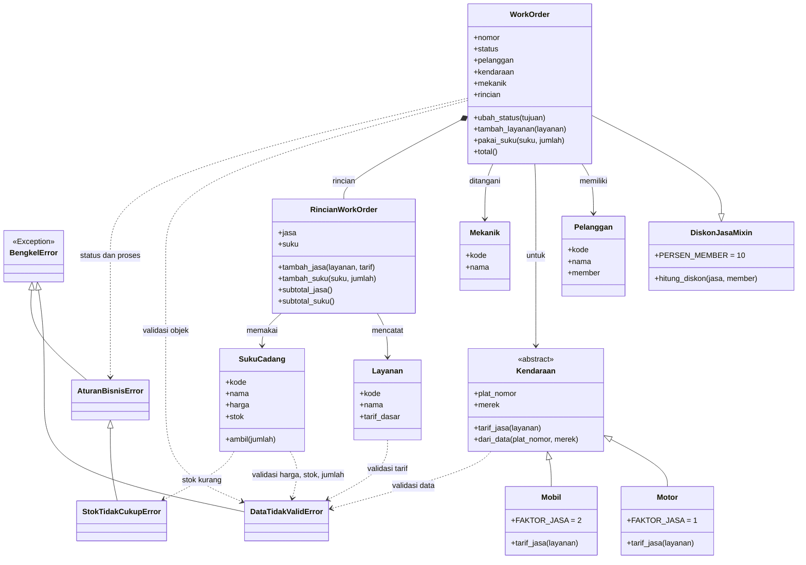

# Sistem Bengkel Servis Kendaraan

Proyek Ujian Tengah Semester Pemrograman Berorientasi Objek (PBO) menggunakan Python. Program mengelola pelanggan, kendaraan, mekanik, layanan servis, suku cadang, dan work order. Proyek ini menambahkan penanganan pengecualian (*exception handling*) sesuai aturan bisnis bengkel.

## Studi kasus

Petugas mencatat pelanggan dan kendaraannya, lalu membuat work order yang ditangani seorang mekanik. Bengkel melayani motor dan mobil dengan tarif jasa berbeda. Saat pekerjaan berlangsung, layanan dan suku cadang yang digunakan dicatat dan stok suku cadang berkurang. Member mendapat diskon jasa 10%, sedangkan suku cadang dibayar penuh.

## Aturan bisnis

1. Tarif dasar jasa dan harga suku cadang harus berupa bilangan bulat positif.
2. Stok suku cadang harus berupa bilangan bulat nol atau lebih.
3. Jumlah suku cadang yang digunakan harus positif dan tidak boleh melebihi stok yang tersedia.
4. Layanan dan suku cadang hanya dapat ditambahkan saat work order berstatus `dikerjakan`.
5. Status work order mengikuti urutan `antre` → `dikerjakan` → `selesai` → `dibayar`.
6. Tarif jasa motor sama dengan tarif dasar layanan; tarif mobil dua kali tarif dasar.
7. Member mendapat diskon 10% dari jasa, sedangkan suku cadang tidak didiskon.

Setter dan method pada kelas domain menggunakan `raise` untuk menolak data tidak valid atau pelanggaran aturan bisnis.

## Hierarki custom exception

- `BengkelError`: base exception untuk kesalahan pada aplikasi bengkel.
- `DataTidakValidError`: data masukan tidak sesuai format atau nilai yang diwajibkan.
- `AturanBisnisError`: operasi melanggar aturan bisnis.
- `StokTidakCukupError`: stok suku cadang kurang dari jumlah yang diminta; turunan `AturanBisnisError`.

Program utama menangani exception dengan blok `try`, `except`, `else`, dan `finally`. Program juga menunjukkan contoh penolakan jumlah stok yang berlebihan dan nilai stok negatif.

## Diagram kelas



## Struktur berkas

```text
.
├── README.md
├── exceptions.py
└── main.py
```

## Cara menjalankan

Pastikan Python 3 sudah terpasang. Jalankan perintah berikut dari folder proyek:

```bash
python main.py
```

## Anggota kelompok

| 1 | | I Wayan Sadu Windhuarta         | 2501010010
| 2 | | I Putu Surya Saputra            | 2501010019
| 3 | | Gusti Ngurah Panji Widyastantra | 2501010022
